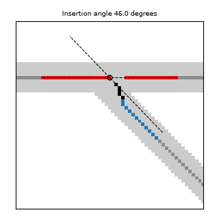

# Choose main root

After [merging](merge.md), a root is a set of branches. One of them is chosen as the main
root. The others become its laterals, and each lateral that meets the main root gets an
insertion angle: the angle at which it leaves the main root.

## Which branch is the main root

| Rule | The main root is the branch with |
|---|---|
| `length` (default) | the greatest length |
| `diameter` | the greatest mean diameter |
| `connectivity` | the most pieces joined into it during merging |
| `combined` | the highest score of 0.7 × its length relative to the longest branch plus 0.3 × its diameter relative to the thickest |

A root with a single branch is its own main root. On a tie, the first branch found wins.

Set the rule with `--root-selection` or `Config(root_selection=...)`; the `combined`
weights with `Config(length_weight=..., diameter_weight=...)`.

The choice changes the `main_root` row and every insertion angle, but none of the
whole-root (`aggregated`) traits.

## Insertion angle

The circle marks where the lateral meets the main root. The red pixels of the main root
and the blue pixels of the lateral set the two directions, drawn as dashed lines. The
black pixels are left out.

1. **Where they meet.** The contact point is where the lateral's skeleton comes closest to
   the main root's, at the junction they share.
2. **Which pixels count.** Near the contact point, the skeleton bends as it runs into the
   junction, over about one root radius. So the lateral's direction is taken from its
   pixels between one root radius and 15 pixels beyond that, measured from the contact
   point. The main root's direction is taken from its pixels within the same distance, on
   both sides. The root radius is measured at the contact point.
3. **Their directions.** Each set of pixels gives one direction: the line along which its
   pixels spread most, the same way the `angle` column is found (see
   [Angle](measurements.md#angle)).
4. **The angle.** The insertion angle is the angle between the two directions, from 0 to 90
   degrees: 90 for a lateral leaving at a right angle, near 0 for one running almost along
   the main root.

The angle stops at 90 degrees because a mask does not show which way the main root grows.
A lateral leaving at 45 degrees toward one end of the main root and one leaving at 45
degrees toward the other end look the same, so both read 45.

The 15 pixels are `Config(insertion_reach_px=...)`. At 300 DPI they are 1.3 mm, at 120 DPI
3.2 mm.

## Branches without an insertion angle

A branch that shares no junction with the main root, such as a branch growing from another
branch, has no insertion angle: its `insertion_angle` cell is empty. This is common. On
2,000 random PRMI masks it was 65% of all branch rows. The
[overview image](output.md#overview-image) shows which branches touch the main root.
