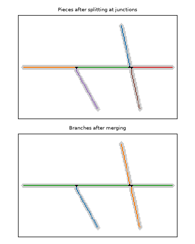

# Merge pieces into branches

[Splitting the skeleton at junctions](split_junctions.md) cuts every root at every
junction, so a single root often ends up in several pieces: a main root is cut wherever
a lateral leaves it. Merging joins these broken pieces back together to get the full root
again. Without it, a main root would be only its longest piece, and every piece would be
counted as a branch.

## How pieces are joined

At each junction, every piece has a direction pointing away from the junction, along the
piece. Two pieces that continue a root straight through the junction point in opposite
directions, so the angle between them is close to 180 degrees. A lateral leaving at a
sharp angle gives a smaller one.

- A pair of pieces is joined when its angle is within 30 degrees of straight, that is
  150 degrees or more.
- When only two pieces meet, the junction is just a bend in one root. They are joined at
  any angle of 90 degrees or more.
- At each junction the straightest pair is joined first, and a piece joins at most once
  there.
- Merging starts from the pieces that end in a root tip and works inward. A joined piece
  is checked again at the next junction along it.

```
            /  Pieces and junctions  /
                         │
                         ▼
┌────────────────────────────────────────────────┐
│            Build the junction graph            │
│    (each piece end to its nearest junction)    │
└────────────────────────────────────────────────┘
                         │
                         ▼
┌────────────────────────────────────────────────┐
│    Queue the pieces that end in a root tip     │
└────────────────────────────────────────────────┘
                         │
                         ▼
┌────────────────────────────────────────────────┐
│       Take the next piece from the queue       │ ◄──┐
└────────────────────────────────────────────────┘    │
                         │                            │
                         ▼                            │
┌────────────────────────────────────────────────┐    │
│     At each undecided junction it reaches:     │    │
│    angle between every pair of pieces there    │    │
└────────────────────────────────────────────────┘    │
                         │                            │
                         ▼                            │
┌────────────────────────────────────────────────┐    │
│         Join pairs, straightest first:         │    │
│        angle >= 150° (180° = straight),        │    │
│        or >= 90° if only 2 pieces meet;        │    │
│       each piece joins once per junction       │    │
└────────────────────────────────────────────────┘    │
                         │                            │
                         ▼                            │
┌────────────────────────────────────────────────┐    │
│           Mark the junction decided            │    │
└────────────────────────────────────────────────┘    │
                         │                            │
                         ▼                            │
┌────────────────────────────────────────────────┐    │
│       Joined pieces go back in the queue       │    │
│      if they reach an undecided junction       │    │
└────────────────────────────────────────────────┘    │
                         │                            │
            queue empty? ──► yes:  /  Branches  /     │
                         │ no                         │
                         └────────────────────────────┘
```

## Example



The main root is cut into three pieces by a lateral and a crossing root. Merging joins
the three pieces into one main root. The lateral stays a separate branch. The crossing
root's two halves continue straight through the junction, so they are joined into one
branch.

A root that crosses another therefore counts as one branch of it, not two.

## Settings

| Setting | Command line | Default | Effect |
|---|---|---|---|
| `merge_method` | `--merge` | `angle` | `angle` as described here; `diameter` joins pieces of similar thickness and direction; `none` keeps every piece as its own branch |
| `merge_angle_threshold` | `--merge-angle` | 30 | how far from straight (degrees) a pair can be and still join |
| `force_merge_min_angle` | Python only | 90 | smallest angle at which two pieces meeting alone are joined |
| `angle_mode` | Python only | `endpoint` | how a piece's direction is taken: the straight line to its other end (`endpoint`), its first 10 pixels (`local`), or `endpoint` unless the two differ by more than 45 degrees (`hybrid`) |

With `diameter` or `none`, pieces shorter than `min_root_length_mm` are dropped before
merging. With `angle`, every piece takes part.

## Limits

- The straightest pair always wins. Where a main root bends at a junction and a lateral
  leaves straighter than the root continues, the lateral is joined as the continuation,
  and the rest of the main root becomes the branch.
- With the default `endpoint` mode, a curved piece's direction is the straight line to its
  far end, which can differ from its direction at the junction.

---

← [Length, diameter and angle](measurements.md) · [Overview](index.md) · [Measure each root](measure_roots.md) · [Choose main root](main_root.md) →
