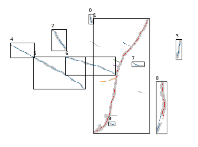

# Output: the trait table

The output is one table with three types of rows for each root. The first is the
`aggregated` row, where the overall traits of the whole root are reported. Then comes the
`main_root` row, for whichever branch was chosen as the main root (see
[Choose main root](main_root.md)). Then there is one `branch` row for each lateral. The
`type` column says which is which, so the whole-root or main-root results can be filtered
out easily.

On the command line, `rhizotrace traits` writes this table for every mask in the folder to
one CSV (`traits.csv` by default). In Python, `extract_traits` returns it as a pandas
DataFrame.

## An example

One root from a sample mask, with four laterals:

```
type        branch  length_mm  avg_diameter_mm  angle  insertion_angle  number_of_branches  length_per_width
aggregated              41.223            0.556   68.9                                    4            74.107
main_root               30.051            0.661   68.4                                    4
branch           0       2.269            0.200  151.7          ...
branch           1       1.897            0.268  155.7          ...
branch           2       1.252            0.190  164.1          ...
branch           3       3.733            0.220   13.0          ...
```

The main root and its branches add up to 39.2 mm, less than the whole root's 41.2 mm. The
pixels at each junction belong to no branch (see [Branches](measurements.md#branches)).
For a root's total length, use the `aggregated` row.

## Rows

- An image can hold several roots. Each gets an `aggregated` row, a `main_root` row, and a
  `branch` row per lateral.
- A root with no laterals has identical `aggregated` and `main_root` rows: the whole root
  is its own main root.
- An image in which no root was found has no rows at all.

## Columns

| Column | aggregated | main_root | branch | Meaning |
|---|---|---|---|---|
| `image` | yes | yes | yes | file name of the mask, without extension |
| `root` | yes | yes | yes | root number within the image, from 0 |
| `type` | yes | yes | yes | `aggregated`, `main_root` or `branch` |
| `branch` | | | yes | lateral number within the root, from 0 |
| `length_mm` | yes | yes | yes | skeleton length |
| `avg_diameter_mm` | yes | yes | yes | mean diameter along the skeleton |
| `diameter_median_mm` | yes | yes | yes | median diameter along the skeleton |
| `diameter_std_mm` | yes | yes | yes | standard deviation of the diameter |
| `angle` | yes | yes | yes | long axis, degrees from 0 to 180 |
| `insertion_angle` | | | yes | angle at which the lateral leaves the main root, 0 to 90 degrees; blank when the branch does not attach to the main root |
| `number_of_branches` | yes | yes | | number of laterals of the root |
| `length_per_width` | yes | | | total length over mean diameter |
| `length`, `avg_diameter`, `diameter_median`, `diameter_std` | yes | yes | yes | the same lengths and diameters in pixels |

How each measurement is made: [Length, diameter and angle](measurements.md).

## Overview image

With `--viz DIR`, `rhizotrace traits` also saves `<image>_overview.png` for every mask. Each
measured root is boxed and numbered with its `root` value from the table. The main root is
drawn in red and each lateral in its own color. A root with no laterals is drawn in blue. Gray
pixels with no box were dropped as too small or too short.



In Python, the same picture comes from `rhizotrace.viz.plot_overview(mask, roots)`, with
`roots` from `extract_roots`.
