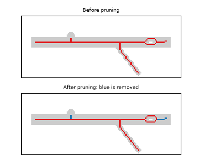

# Prune spurs

Turning a mask into a skeleton leaves small spurs: short false twigs that come from bumps
on the root's outline or from a ragged tip, not from real branches. Left in place, each
spur would be counted as a branch. Pruning removes them to reduce noise in the results.

A spur is recognized by comparing its length with the root's diameter where it joins the
root. The rule is deliberately careful, so that real branches are not pruned.

## The rule

A **terminal piece** is a piece of skeleton with a free end that meets the rest of the
root at exactly one junction. A terminal piece is removed when it is shorter than **k
times the local diameter**. The local diameter is the root's thickness at the junction:
twice the largest distance from the junction to the root's edge. A thick root can carry
larger bumps than a thin one, so the limit scales with it.

k is set with `--spur-length-diameters` on the command line or
`Config(spur_length_diameters=...)` in Python. The default is 1.0. Set it to 0 to turn
pruning off.

Removing one spur can expose another, so pruning repeats until a pass removes nothing.

```
          /  Skeleton of one root  /
                       │
                       ▼
┌────────────────────────────────────────────┐
│        Split skeleton at junctions         │ ◄──┐
└────────────────────────────────────────────┘    │
                       │                          │
         no junctions? ──► done                   │
                       │ no                       │
                       ▼                          │
┌────────────────────────────────────────────┐    │
│     Measure the length of every piece      │    │
└────────────────────────────────────────────┘    │
                       │                          │
                       ▼                          │
┌────────────────────────────────────────────┐    │
│      At each junction: local diameter      │    │
│        and which pieces meet there         │    │
└────────────────────────────────────────────┘    │
                       │                          │
                       ▼                          │
┌────────────────────────────────────────────┐    │
│            Mark terminal pieces            │    │
│       (free end, one junction only)        │    │
└────────────────────────────────────────────┘    │
                       │                          │
                       ▼                          │
┌────────────────────────────────────────────┐    │
│    Remove terminal pieces shorter than     │    │
│            k x local diameter,             │    │
│   keeping at least 2 pieces per junction   │    │
└────────────────────────────────────────────┘    │
                       │                          │
     anything removed? ──► no: done               │
                       │ yes                      │
                       ▼                          │
┌────────────────────────────────────────────┐    │
│          Clean up leftover stumps          │ ───┘
└────────────────────────────────────────────┘

    (repeat until a pass removes nothing)
```

## Two safeguards

- **Loops are never cut.** A piece that leaves a junction and returns, as around a hole,
  has no free end, so it is never a terminal piece. Cutting a loop would break the root
  in two.
- **Every junction keeps at least two pieces.** When a ragged tip splits into two short
  arms, both are below the limit. Only the shorter one is removed, so the tip keeps its
  longer arm and the root is never pruned away entirely.

## Example



The bump on the top edge is removed. The real lateral below is kept, because it is much
longer than the root is thick. The short end of the root past the hole on the right is
also removed: see the limits below.

## Limits

- A real lateral shorter than k times the local diameter is removed as a spur.
- A short real tip just past a hole looks like a spur and is removed, as in the example.
- Every measurement is made on the pruned skeleton, including the whole-root
  (`aggregated`) row. Pruning therefore shortens total length slightly, not only the
  branch count.
