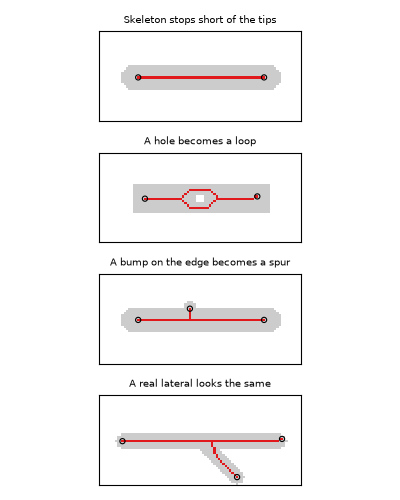
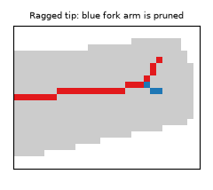

# Skeletonize: thin to a 1-pixel line

Skeletonizing reduces each root to a line one pixel wide that runs down its middle. This
line, the skeleton, covers the whole root, branches included. It makes the root easy to
work with: length is measured along it, and junctions and branches are found on it.

The skeleton comes from scikit-image's
[`skeletonize`](https://scikit-image.org/docs/stable/api/skimage.morphology.html#skimage.morphology.skeletonize),
which uses the thinning algorithm of Zhang and Suen (1984) for 2D images.

## What skeletonizing does to a root shape

Mask in gray, skeleton in red, free ends circled.

- **The skeleton stops short of the tips.** It ends about one root radius before each
  tip. Length measured on the skeleton therefore comes out about one diameter shorter
  than the root. This is negligible on long thin roots and noticeable on short thick ones.
- **A hole becomes a loop.** The skeleton goes around both sides of a hole in the mask.
  Each loop adds two junctions, and both sides of the loop count toward length. A single
  missing pixel is enough to make a loop. rhizotrace does not fill holes, so if your
  masks have small holes that are not real gaps, fill them before running.
- **A bump on the edge becomes a spur.** A bump on the root's outline becomes a short
  side twig on the skeleton. It looks exactly like a real lateral. The only difference is
  its length compared with the root's thickness. [Prune spurs](prune_spurs.md) removes
  these.
- **A ragged tip can split into a fork.** An irregular tip can end in two short arms.
  Pruning keeps the longer arm.

## References

Zhang, T. Y., & Suen, C. Y. (1984). A fast parallel algorithm for thinning digital
patterns. *Communications of the ACM*, 27(3), 236-239. https://doi.org/10.1145/357994.358023
